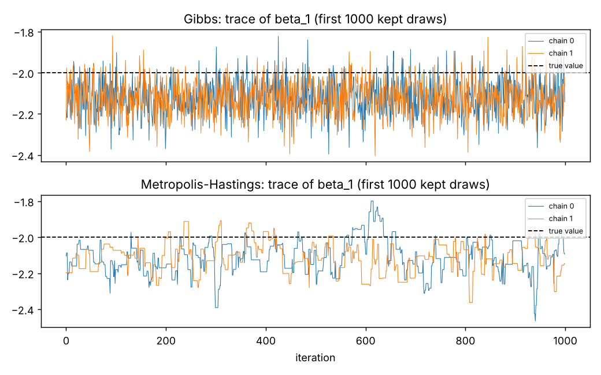
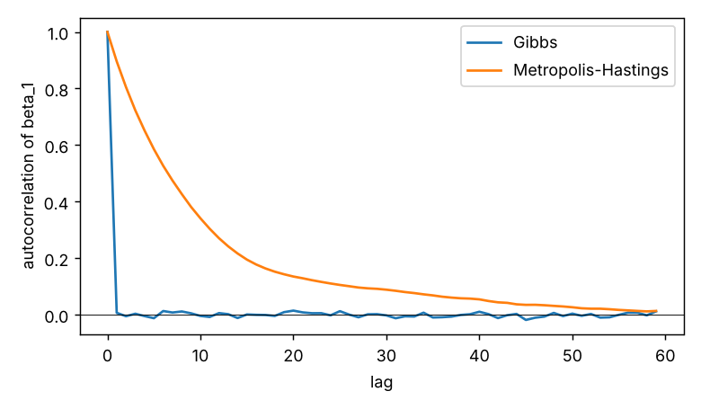

# mcmc-sampler

Metropolis-Hastings and Gibbs samplers for Bayesian linear regression, with the convergence diagnostics (split R-hat, effective sample size, autocorrelation) written from scratch in NumPy. The point is to compare how the two samplers **mix** on the same posterior and to check that the answers can be trusted.

## In one paragraph

Bayesian linear regression puts priors on the coefficients β and the noise variance σ², and the posterior has no closed form. So I sample from it two ways:
- **Gibbs** alternates exact draws of β given σ² and σ² given β, which works because both conditionals are standard distributions.
- **Metropolis-Hastings** proposes a random step and accepts it with probability min(1, posterior ratio); it only needs the posterior up to a constant.

Both give the same answer (all R-hat ≤ 1.004), but MH's draws are strongly autocorrelated: from the same 20,000 draws, Gibbs gives **11–23× more effective samples**. Over 200 simulated datasets, the 95% credible intervals contained the true values 92.5–96% of the time, so the uncertainty estimates are trustworthy too.

## Results

Synthetic data: n = 200, an intercept plus two correlated predictors, true β = (1, −2, 0.5), σ² = 1. Four chains per sampler start from dispersed points, and each keeps 5,000 draws after burn-in (`seed = 0`, `make experiment`).

| param | truth | posterior mean | 95% credible interval | Gibbs R-hat | Gibbs ESS | MH R-hat | MH ESS |
|---|---|---|---|---|---|---|---|
| β₀ | 1.000 | 0.997 | [0.858, 1.136] | 1.000 | 20,080 | 1.003 | 1,747 |
| β₁ | −2.000 | −2.122 | [−2.289, −1.955] | 1.000 | 19,728 | 1.002 | 939 |
| β₂ | 0.500 | 0.620 | [0.482, 0.757] | 1.000 | 20,167 | 1.004 | 1,184 |
| σ² | 1.000 | 0.998 | [0.820, 1.212] | 1.000 | 18,631 | 1.003 | 798 |

ESS is out of 20,000 total draws (4 chains × 5,000).

- **Both samplers agree, and all R-hat values are ≤ 1.004.** That is below the usual 1.01 warning level, so the chains have converged to the same distribution.
- **Gibbs gives 11–23× more effective samples than MH** from the same number of draws (for example 19,728 vs 939 for β₁). Gibbs draws are close to independent; the MH autocorrelation takes about 40 lags to die out (`artifacts/acf.png`).
- **Per second, Gibbs is still 3–7× more efficient.** An MH step is cheaper (0.49 s vs 1.64 s for all four chains in this run, burn-in included), but not cheap enough to make up for the autocorrelation. Timings depend on the machine.
- **The credible intervals are calibrated.** All four intervals above contain the true value. One dataset can't show calibration, though, so `make coverage` refits 200 simulated datasets: the 95% intervals contained the truth 93.5%, 96.0%, 95.5% and 92.5% of the time for β₀, β₁, β₂ and σ². The Monte Carlo standard error is 1.5 points, so all four are consistent with 95%.

The posterior means sit near the least-squares fit (0.997, −2.122, 0.620) rather than the true β. With a weak prior and n = 200 that is expected; the gap comes from noise in this one dataset, not from the sampler.

<p align="center"> </p>

## The model

```
y | β, σ²  ~  N(Xβ, σ² I)
β          ~  N(m₀, V₀)          (default m₀ = 0, V₀ = 100 I)
σ²         ~  InvGamma(a₀, b₀)   (default a₀ = 2, b₀ = 1)
```

The prior on β doesn't scale with σ² (a *semi-conjugate* prior), so the joint posterior has no closed form. Both full conditionals do, though:

```
β  | σ², y  ~  N(mₙ, Vₙ),   Vₙ = (V₀⁻¹ + XᵀX/σ²)⁻¹,   mₙ = Vₙ (V₀⁻¹ m₀ + Xᵀy/σ²)
σ² | β,  y  ~  InvGamma(a₀ + n/2,  b₀ + ‖y − Xβ‖² / 2)
```

## The two samplers

**Gibbs** (`gibbs.py`) alternates exact draws from the two conditionals above. There are no tuning parameters and every draw is accepted. It moves all of β in one block, so correlation *between* the β's costs it nothing. Its weakness is that it needs conditionals you can sample from, which most models don't have.

**Random-walk Metropolis-Hastings** (`mh.py`) only needs the unnormalized log posterior. It works on θ = (β, log σ²) so the proposal never has to respect σ² > 0; the log-transform adds a Jacobian term (`+ log σ²`) to the log density, which `model.log_post` includes. The proposal is isotropic N(θ, s²I). During burn-in, s is adapted toward a 23.4% acceptance rate (the classic optimum for random-walk proposals); then adaptation is frozen, so the kept draws come from a fixed Markov chain and the usual MCMC guarantees apply. Final acceptance rates were 20–27%.

**Why MH loses here.** The correlated predictors make the posterior for β an elongated ellipse. An isotropic proposal has to use a step small enough for the narrow direction, so it crawls along the long one. That is the autocorrelation in the trace plot.

Alternatives considered and not used:
- *Adapting the MH proposal throughout the run*: breaks the Markov property unless the adaptation is made to vanish, so adaptation is restricted to burn-in.
- *A proposal shaped by the posterior covariance*: would close much of the gap, but it needs either a pilot run or the very covariance Gibbs already exploits. The point here is to show the plain random-walk cost.
- *Hamiltonian Monte Carlo*: the right tool for larger models, but outside this project's scope.

## Diagnostics (`diagnostics.py`)

- **Autocorrelation** is computed with an FFT (O(n log n) instead of O(n²)).
- **ESS** = total draws / (1 + 2 Σ ρₖ). The sum of autocorrelations is cut off with Geyer's initial positive sequence (adjacent pairs are added until a pair is negative). A fixed cutoff lag is the alternative: too short underestimates the autocorrelation time, too long just adds noise.
- **Split R-hat** compares between-chain and within-chain variance after splitting every chain in half. Splitting is what catches a single chain that drifts within itself, which plain Gelman-Rubin R-hat can miss (there's a test for exactly this case).

## Tests

`make test` runs 11 tests:
- ESS of i.i.d. draws ≈ n.
- ESS of an AR(1) chain matches theory, n(1 − φ)/(1 + φ).
- R-hat is near 1 for agreeing chains, flags chains stuck in different places, and catches a single drifting chain.
- The β conditional reduces to OLS under a flat prior.
- The curvature of the log posterior matches the conditional precision.
- Gibbs recovers the parameters.
- MH agrees with Gibbs.
- Samplers are reproducible with a fixed seed.

## How to run

```bash
pip install -e ".[dev]"     # or: make setup
make test                   # 11 tests
make experiment             # results table, artifacts/results.json, traces.png, acf.png
make coverage               # repeated-simulation coverage check, artifacts/coverage.json (~30 s)
```

## Layout

```
src/mcmc_sampler/
├── model.py         # model, full conditionals, log posterior, synthetic data
├── gibbs.py         # Gibbs sampler
├── mh.py            # random-walk MH with burn-in-only adaptation
└── diagnostics.py   # autocorrelation, ESS, split R-hat, summary table
scripts/             # run_experiment.py, coverage_check.py
tests/               # 11 tests
```

## Limitations

- Only one model (linear regression) and synthetic data. The diagnostics are general; the samplers are specific to this model.
- The MH proposal is deliberately simple, so the comparison shows the cost of a naive random walk, not the best MH can do.
